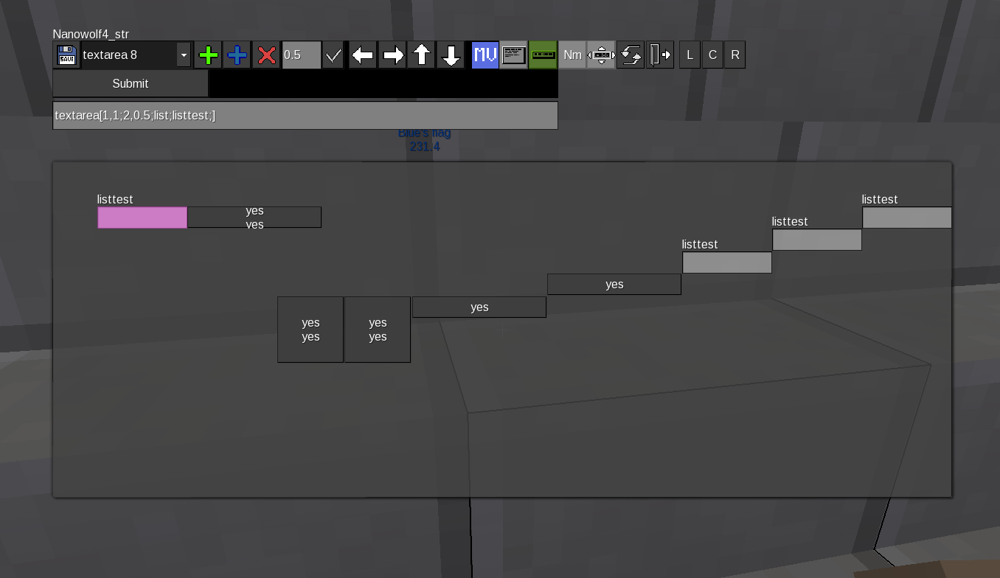

# SFSE

SFSE (**S**imple **F**orm**S**pec **E**ditor) is a Luanti mod created to make formspec development much faster and easier for Luanti mod authors. Instead of the usual "write code -> restart/test -> fix positions blindly" loop, SFSE lets you edit a formspec **in real time, right inside the running game**: every change you make is applied to the live rendering of the form immediately, following the *"do it — see it"* principle.

## Screenshot

## What it does

The mod is an in-game visual editor for [Formspec](https://github.com/luanti-org/luanti/blob/master/doc/lua_api.md#formspecs) (Luanti's GUI description language). While you work, the actual form is rendered as it would appear in your mod, with an editor toolbar, selection handles and helpers layered on top of it.

The editor can be used in two ways:

* **Standalone** — you edit one of the built-in demo projects (or a project you registered yourself) purely to design and experiment with a form.
* **Intercepting real forms** — SFSE can hijack formspecs that other mods show to you and open them in the editor, so you can study, tweak and re-create real-world GUIs.

## Features

* **Real-time WYSIWYG editing** — the form is rendered live while you edit it; no server restarts or blind guesswork. All changes are visible instantly.
* **Move & resize** — nudge a selected element in any direction with the arrow keys or resize it, using a configurable step size.
* **Multi-line source editor** — view and edit the whole project as a raw formspec string, then re-parse it into the editable element structure with one click.
* **Single-line quick editor** — edit the currently selected element as a one-line formspec string; submitting an empty string deletes the element.
* **Element toolbox** — add a new empty element, duplicate (copy) the selected element, or delete an element, all from the toolbar.
* **Alignment** — align the selected element to the **left**, **center**, or **right** edge of the form.
* **Element selector** — a dropdown lists every element of the project in order, so you can jump straight to the one you need.
* **Selected-element highlight** — the currently edited element is outlined with a translucent highlight box for easy identification.
* **Toolbar repositioning** — the editor toolbar can be moved around the screen if it overlaps with the form being edited.
* **Export dialog** — export the result either as a **Formspec string** or as an **fslib-style element table** (Lua code); copy it from the text area, print it to the server log, or save it straight to a file inside the mod's `export/` folder.
* **Formspec capture** — SFSE wraps `core.show_formspec` and can intercept formspecs shown by the engine or by any other mod, opening them in the editor instead (see *"Editing formspecs of other mods"* below).

## Requirements

* **Luanti 5.10.0 or newer** (formerly known as Minetest).
* The editor cannot edit formspecs that use a `formspec_version` **lower than 4**.
* The player needs the **`formspec_editor`** privilege (granted to singleplayer automatically).

## Usage

### Opening a project

Use the chat command:

    /fsopen <project_name>

For example, open one of the bundled demo projects:

    /fsopen test

To reopen the **last** project you worked on, use:

    /fsopen !

### Editor overview

The editor window is a live rendering of your form plus an overlay toolbar. From left to right, the toolbar provides:

| Control | Action |
|---|---|
| **Export** | Opens the export dialog (Formspec string or table dump). |
| **Element dropdown** | Selects which element of the project you are editing. |
| **Add new** | Appends a new blank element to the project. |
| **Add copy** | Duplicates the currently selected element. |
| **Remove** | Deletes the currently selected element. |
| **Step field** | Sets the nudge step size (default `0.5`) used by the arrow keys. |
| **Arrow buttons** | Move / resize / move-the-toolbar depending on the active mode. |
| **Move / Resize toggle** | Switches arrow buttons between moving and resizing the element. |
| **Text editor** | Opens the full multi-line editor for the entire formspec source. |
| **Quick editor** | Opens the one-line editor for the selected element. |
| **Nm (name)** | Opens the formname / project rename editor. |
| **Move toolbar** | Switches arrow buttons to reposition the editor toolbar itself. |
| **Reload** | Forces a full regeneration of the preview (useful after raw-text edits). |
| **Exit** | Closes the current editing session. |

Alignment buttons **L / C / R** align the selected element to the left, centre, or right of the form width.

**Editing tips**

* The first two project entries (`formspec_version` and `size`) are essential defaults: they are inserted automatically when missing and are protected from deletion.
* New elements can only be added *after* the `size[]` entry.
* The full-source text editor accepts a whole formspec string. Press **Submit** to parse it back into editable elements. If you see the message about a syntax error, a square bracket is probably missing.
* Renaming a project changes its formname — a tooltip warns you that other mods may depend on the current formname.

### Editing formspecs of other mods (capture)

SFSE can open formspecs shown by *other mods* in the editor:

* `/fs_capture <formname>` — start capturing the form with the given formname every time it is shown to you.
* `/fs_capture` — list the formnames you are currently capturing.
* `/fs_uncapture <formname>` — stop capturing that formname.
* `/fs_capture_next` — toggles a one-shot mode that captures the very next formspec shown to you, whatever its name.

When a form is captured, SFSE intercepts `core.show_formspec` and opens the editor with that form instead. You can then rearrange elements, see how it behaves live, and export the result.

### Exporting the result

The **Export** button opens a dialog with a large read-only text area. Use the tabs at the top to switch between:

1. **Formspec String** — the ready-to-use formspec string for your mod code.
2. **Dump Table (fslib)** — the same form as a Lua element table in fslib style.

From there you can:

* copy the text manually and paste it into your mod;
* press **Print to log** to write it into the server console/log;
* press **Save to file** to store it in the mod's `export/` directory as `<player>_<project>_<date>`.

The exported content is **plain text or Lua data** — SFSE does not write or modify your mod's source files; integration into your code is up to you.

## API for modders

SFSE exposes a small API on the global `sfse` table:

* `sfse.projects` — a table of available projects: `name -> {formspec string | element table}`. Add your own projects here and they will be parsed when the mods finish loading.
* `sfse.open_formspec(player_name, formname, formspec)` — programmatically open an arbitrary formspec in the editor for a player (used internally by the capture system).
* `sfse.formspec_to_table(formspec)` — parse a formspec string into a table of elements (returns `table, err`).
* `sfse.build_formspec(table_or_string)` — serialize an element table back into a formspec string (fslib-style builder).
* `sfse.show_formspec(player, formspec, handler)`, `sfse.reshow_formspec(...)`, `sfse.close_formspec(player)` — helpers from the bundled, simplified fslib that SFSE's own windows are built on.

The mod wraps `core.show_formspec` and adds an optional `skip_intercept` argument; when a player has capture enabled for a formname, the call is redirected into the editor instead.

## Use cases

* **Building GUIs for Luanti mods** — design inventory forms, crafting GUIs, admin panels, settings dialogs and similar formspec-heavy UI visually and fast.
* **Learning Formspec** — see how elements, positions, sizes, containers, `noclip` and escape sequences actually behave, without endless trial-and-error cycles.
* **Debugging layout** — fix overlapping or misaligned elements of your own forms by moving and resizing them live, then exporting the corrected coordinates.
* **Studying other mods** — capture and inspect the formspecs other mods produce at runtime.
* **Prototyping** — quickly test an idea for a form before writing any code, using the built-in demo projects.

## Limitations & notes

* Requires **Luanti 5.10.0+**; older engine versions are not supported.
* **Formspecs with a `formspec_version` below 4 cannot be edited.**
* Only players with the `formspec_editor` privilege can use the editor and the capture commands.
* All projects are kept in memory during a session and are lost when the server shuts down — always export your work.
* The built-in syntax check is simple: unbalanced or missing square brackets are reported, but deep semantic errors of a form are only visible in the live preview.

## License

* The SFSE mod itself: **GPLv3**, Copyright (c) 2022–2026 Nanowolf4 (n4w@tutanota.com). See `license.txt`.
* `simple_fslib.lua`: MIT — Copyright 2022 Lars Müller; based on [fslib](https://github.com/appgurueu/fslib). See `fslib_license.txt`.

**Author:** Nanowolf4 (n4w@tutanota.com)
